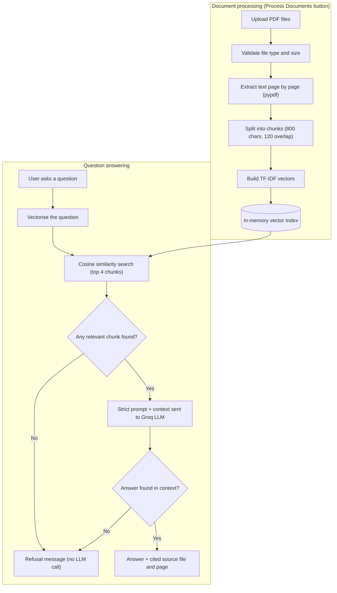

# Sam Chatbot: Domain-Specific RAG Chatbot for PDF Question Answering


Sam Chatbot lets you upload PDF documents (policies, manuals, course notes, handbooks) and ask questions in plain English. It retrieves the most relevant passages from your documents and generates an answer **based only on those passages**, showing the source file and page number for every answer. If the answer is not in the documents, it says so instead of guessing.

**Author:** Divyesh Tiwari

---


**Live demo:** https://sam-chatbotai.streamlit.app/


[](https://sam-chatbotai.streamlit.app/)

> The demo runs on Streamlit Community Cloud and may need a few seconds to wake up if it has been idle. Upload a PDF in the sidebar, click **Process Documents**, then ask your questions.


## Table of contents

1. [Features](#features)
2. [How it works](#how-it-works)
3. [What I did differently from the project guideline, and why](#what-i-did-differently-from-the-project-guideline-and-why)
4. [Tech stack](#tech-stack)
5. [Project structure](#project-structure)
6. [Setup](#setup)
7. [Usage](#usage)
8. [Testing and evaluation](#testing-and-evaluation)
9. [Responsible AI and security](#responsible-ai-and-security)
10. [Limitations](#limitations)
11. [Future improvements](#future-improvements)

---

## Features

- Upload one or more PDF files, with file type and size validation (PDF only, 20 MB per file).
- Page-by-page text extraction that keeps the document name and page number as metadata.
- Chunking with overlap so that connected ideas are not cut apart.
- Retrieval of the top 4 most relevant chunks for every question.
- Grounded answers from a strict prompt: the model may only use the retrieved context.
- Source display under every answer (file name and page), showing only the sources the answer actually used.
- A clear refusal message when the information is not available, with no invented facts.
- Streamlit interface with a sidebar uploader, **Process Documents** button, chat history, **Clear Chat** and **Clear Documents** buttons.
- An automated evaluation script and a 23-question test sheet.

## How it works



1. **Load:** each PDF is read page by page with `pypdf`. Empty pages are skipped, and every page keeps its file name and page number.
2. **Chunk:** each page is split separately with LangChain's `RecursiveCharacterTextSplitter` (chunk size 800, overlap 120), so a chunk never mixes two pages and page numbers stay correct.
3. **Index:** all chunks are converted into TF-IDF vectors (unigrams and bigrams, English stop words removed, sublinear term frequency, Unicode normalisation so that ligatures such as "fi" become "fi").
4. **Retrieve:** the question is vectorised the same way. Because TF-IDF vectors are L2-normalised, the dot product with the chunk matrix equals cosine similarity. Chunks with a score of 0 are dropped, and the top 4 remain.
5. **Generate:** the retrieved chunks and the question are sent to a Groq-hosted LLM (temperature 0) with a strict system prompt.
6. **Cite:** the answer is checked for the file and page citations the model wrote, and only those sources are displayed. If no citation can be parsed, the best-scoring chunk is shown.

## What I did differently from the project guideline, and why

The project guideline suggests Sentence Transformers (`all-MiniLM-L6-v2`) for embeddings and FAISS as the vector database. This project uses **TF-IDF** and a **NumPy cosine-similarity search** instead.

### The reason

While setting up the project on my Windows laptop, both `torch` (required by Sentence Transformers) and `faiss-cpu` installed successfully but **failed to load**:

- `ImportError: DLL load failed while importing _swigfaiss: An Application Control policy has blocked this file.`
- `OSError: [WinError 4551] An Application Control policy has blocked this file. Error loading ...\torch\lib\torch_python.dll`

The Windows Code Integrity log confirmed that **Smart App Control** blocked these unsigned DLL files (`Smart App Control Block Details`, policy "did not meet the Enterprise signing level requirements"). I chose not to turn off a Windows security feature just to run a college project, so I redesigned the retrieval layer to avoid these two libraries.

### Comparison

| Component | Guideline suggestion | This project | Notes |
|---|---|---|---|
| Embeddings | Sentence Transformers `all-MiniLM-L6-v2` | **TF-IDF** (scikit-learn) | Keyword-based, not a pretrained neural model. Needs no model download and no PyTorch. |
| Vector search | FAISS | **NumPy** cosine similarity over a sparse TF-IDF matrix | Same idea: store vectors, return the nearest chunks by cosine similarity. |
| Vector store persistence | Save locally (optional) | Rebuilt in memory on **Process Documents** | Optional in the guideline. Indexing the sample PDFs takes under a second. |
| RAG framework | LangChain | LangChain text splitter and `langchain-groq` connector, with a small hand-written pipeline | The retrieve, prompt and answer flow is explicit and easy to read. |
| Source display | Source document and page | Only the sources the answer **actually cited** | Avoids showing unrelated documents (see below). |

### Other deliberate choices

- **Sources shown only when cited.** In an early version the app listed the page of every retrieved chunk, which sometimes showed a document that had nothing to do with the question. The app now reads the citations the model wrote and displays only those.
- **Two-level refusal.** If no chunk matches the question at all, the app refuses immediately without calling the LLM. If chunks are found but the model cannot answer from them, the model returns the same fixed refusal message.
- **Evaluation script.** `run_tests.py` runs the whole test sheet automatically and writes a results file, instead of testing by hand.

### Trade-offs of TF-IDF

TF-IDF matches **words**, not **meaning**. If a user phrases a question with words that never appear in the PDF (for example "vacation" when the document says "leave"), retrieval can be weaker than with neural embeddings. This did not affect my test sheet because the questions share vocabulary with the documents, but it is the main limitation of this design (see [Future improvements](#future-improvements)).

## Tech stack

| Part | Tool |
|---|---|
| Language | Python 3.11 |
| PDF text extraction | pypdf |
| Text splitting | LangChain text splitters |
| Retrieval | scikit-learn TF-IDF, NumPy |
| LLM | Groq API via `langchain-groq` (default model `openai/gpt-oss-120b`) |
| User interface | Streamlit |
| Configuration | python-dotenv |

## Project structure

```
Sam Chatbot/
|-- app.py                  # Streamlit user interface
|-- rag_pipeline.py         # Retrieval, LLM call, source selection
|-- document_loader.py      # PDF validation and page-by-page text extraction
|-- vector_store.py         # Chunking, TF-IDF index and cosine search
|-- prompt.py               # Strict system prompt and refusal message
|-- run_tests.py            # Automated evaluation of the test sheet
|-- list_models.py          # Helper that lists the Groq models your key can use
|-- requirements.txt
|-- README.md
|-- .env                    # Your API key (never committed)
|-- documents/              # Sample PDFs
|   |-- NovaTech_HR_Policy.pdf
|   |-- Greenfield_Student_Handbook.pdf
|   |-- AquaPure_X200_Manual.pdf
|   |-- sample.pdf
|-- tests/
    |-- test_questions.csv  # 23 test questions with expected sources
    |-- test_results.csv    # Output of run_tests.py
```

## Setup

You need Python 3.10 to 3.12 and a free Groq API key from <https://console.groq.com> (API Keys, then Create API Key).

**1. Open a terminal in the project folder and create a virtual environment**

```bash
python -m venv venv
```

**2. Activate it**

```bash
# Windows (PowerShell)
venv\Scripts\Activate.ps1

# macOS / Linux
source venv/bin/activate
```

**3. Install the dependencies**

```bash
pip install -r requirements.txt
```

**4. Create a `.env` file** in the project folder with your key:

```
GROQ_API_KEY=your_key_here
GROQ_MODEL=openai/gpt-oss-120b
```

Do not add quotes or spaces. `GROQ_MODEL` is optional. Groq changes its model list from time to time, so if you get a "model not found" error, run `python list_models.py` to see the chat models available to your key and put one of them in `GROQ_MODEL`.

## Usage

```bash
streamlit run app.py
```

1. In the sidebar, upload one or more PDFs (the files in `documents/` are good for a first try).
2. Click **Process Documents** and wait for the "chunks ready" message.
3. Type a question in the chat box at the bottom of the page.
4. Read the answer and check the sources shown under it.
5. Use **Clear Chat** to start a new conversation or **Clear Documents** to remove the loaded files.

Example questions for the sample documents:

| Question | Expected answer | Source |
|---|---|---|
| How many casual leave days does an employee get per year? | 12 days | NovaTech_HR_Policy.pdf, page 2 |
| What is the minimum attendance needed to sit for the end-semester exam? | 75 percent | Greenfield_Student_Handbook.pdf, page 1 |
| How often should the RO membrane be replaced? | Every 24 months | AquaPure_X200_Manual.pdf, page 3 |
| Who is the company CEO? | Refusal message | none |

## Testing and evaluation

The sample documents are three fictional PDFs created for this project (an HR policy, a student handbook and a product manual), so the correct answers cannot come from the model's own knowledge. The test sheet `tests/test_questions.csv` contains **23 questions**: 18 answerable questions spread across the three documents, and 5 unavailable questions (including "What is the capital of France?") that must be refused.

Run the evaluation:

```bash
python run_tests.py
```

The script loads the three PDFs, asks every question, checks the answer and the cited source, and saves the details to `tests/test_results.csv`.

**Final results**

| Metric | Result |
|---|---|
| Correct answers (answerable questions) | 18 / 18 |
| Correct source file and page | 18 / 18 |
| Correct refusals (unavailable questions) | 5 / 5 |
| Average response time | about 5.3 seconds |

How the answer check works: for answerable questions the script compares the numbers in the expected answer with the numbers in the model's answer (for example "12", "4500" or "10:00"), so it is a rough automatic check, and any failed row should be read manually. While building the checker, two "failures" turned out to be correct answers written differently ("Three tanks" instead of "3", and a special hyphen character inside a phone number), and the checker was fixed to handle both.

Metrics covered: retrieval accuracy, answer correctness, groundedness, refusal quality, source quality and response time.

## Responsible AI and security

- API keys live in `.env`, which is listed in `.gitignore` and never committed.
- Only PDF files up to 20 MB are accepted.
- The prompt tells the model to ignore any instructions found inside the documents, so text such as "ignore the previous rules" in a PDF is treated as plain content.
- The interface shows a notice that AI answers can be wrong and important information should be verified in the original document.
- The model is told never to invent facts, and the app refuses when nothing relevant is found.
- The text of retrieved chunks is sent to the Groq API to generate answers. **Do not upload confidential documents** without permission.

## Limitations

- **Scanned PDFs are not supported.** There is no OCR, so image-only pages are skipped. The app warns when a file has no extractable text.
- **Keyword retrieval.** TF-IDF does not understand synonyms (see the trade-offs above).
- **No conversation memory.** Every question is answered independently, so follow-up questions such as "and what about the second one?" do not work.
- **Free-tier limits.** Groq rate limits can slow down or temporarily block requests during heavy use.
- **Index is not saved.** Documents must be processed again after restarting the app.

## Future improvements

- Replace TF-IDF with `all-MiniLM-L6-v2` embeddings and FAISS on a machine or server where these libraries are allowed to run. Only `vector_store.py` needs to change, because the rest of the app only calls the `build()` and `search()` methods of the store.
- Add OCR for scanned PDFs.
- Add conversation memory for follow-up questions.
- Save and reload the index to avoid re-processing documents.
- Add feedback buttons for helpful or incorrect answers.
- Deploy with Docker or Streamlit Community Cloud.

---

**Author:** Divyesh Tiwari
